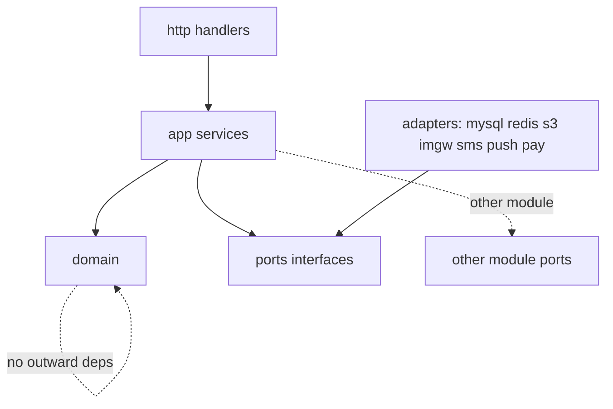
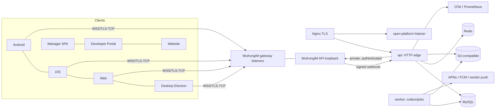
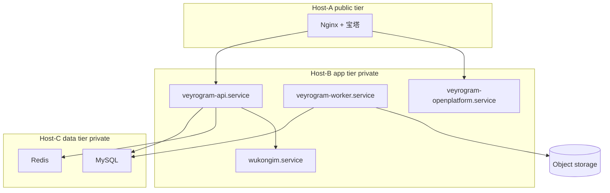

# Architecture Spine — VeyroGram

## Design Paradigm

**Modular monolith, hexagonal per module.** One Go module, many in-process domain modules; each module owns its tables, exposes a typed Go interface (port) to other modules, and talks to the outside world (MySQL, Redis, S3, WuKongIM, SMS, push, payment) only through adapters. No microservices until measured need.

Namespaces (under `services/`): `api` (HTTP edge + composition root), `worker` (outbox/jobs binary), `open-platform` (separate listener, same module), `internal/<module>/{domain,app,ports,adapters}`.



## Invariants & Rules

### AD-1 — Dependency direction
- **Binds:** all Go code.
- **Prevents:** modules reaching into each other's tables/internals; domain code importing drivers.
- **Rule:** `http → app → domain`; `adapters → ports`; a module may call another only via its `ports` package; cross-module DB access is forbidden (enforced by an import-graph lint in CI). Modules: `identity, device, contact, group, message, media, moment, favorite, sticker, support, moderation, admin, audit, openplatform, billing, notification, search, rtc, config`.

### AD-2 — IM core is unreachable except through the IM Gateway adapter  [R-21, NFR-2, NFR-16]
- **Binds:** FR-6..FR-11, FR-35..37, NFR-2, NFR-15, NFR-16.
- **Prevents:** forging sends or tokens via WuKongIM's unauthenticated business API.
- **Rule:** WuKongIM API (default 5001) listens on loopback or a private interface and is called only by the `imgw` adapter inside the business service/worker; no Nginx location, bot, mini-app or client may reach it. **Verified upstream facts (WuKongIM@7b810e08):** the WuKongIM webhook sender attaches no signature, and the gateway has no native TLS. Therefore: IM→business webhooks land on a **separate internal listener** that Nginx never routes, bound to loopback/private only, protected by network isolation plus an unguessable per-environment path secret, strict body validation and idempotency; adding HMAC signing to the pinned fork is a tracked work item (AD-18). Public clients reach the gateway only through Nginx (WSS, or TCP via `stream` TLS termination); gateway listeners bind private addresses; PROXY protocol is accepted only from the Nginx CIDR (AD-16). Production config disables the plugin system and runtime plugin hot-load, disables MQTT unless a FR needs it, and overrides every upstream default secret (`cluster.join_token`, `[manager]` users/`jwt_secret`, `[bench] api_token`). A CI/staging negative test proves these are unreachable from non-allowlisted sources: API 5001, Manager 5301, cluster 7001, metrics 9099, pprof/debug routes, MQTT, any TCP gateway port not fronted by Nginx.

### AD-3 — Server-side object-level authorization, deny by default
- **Binds:** NFR-1, all FRs.
- **Prevents:** UI-only permission control; IDOR.
- **Rule:** every handler declares a `policy` (subject, action, resource, tenant); the policy engine is the single decision point; a route without a policy fails startup. Policies are table-driven and covered by generated negative tests (non-owner, removed member, blocked user, other tenant, expired token). Admin RBAC uses the same engine with role→permission mapping and approval requirements for high-risk actions.

### AD-4 — Message ownership, pipeline, idempotency and Content Type Registry
- **Binds:** FR-6..FR-10, FR-8.
- **Prevents:** duplicate/out-of-order messages; incompatible custom messages across clients.
- **Rule:** **ownership split:** WuKongIM owns message bodies, per-channel sequence and delivery; MySQL owns *business state about messages* (`message_tombstone`, `message_edit`, reactions, receipts, retention/expiry decisions) and is authoritative for **visibility**. Every read path (history sync, search, download, export) filters by MySQL visibility. Physical purge on retention/recall/account deletion is a worker job calling the IM API where the pinned WuKongIM supports it; where it does not (no single-message delete route exists in the audited API surface: only `/message/update`, `/messages`, `/message/sync*`, conversation delete), content is replaced via a tombstone/edit message and the limitation is documented. The client generates `client_msg_id` (ULID); deduplication relies on the IM's native durable idempotency keyed by (from_uid, `client_msg_no`, channel) — verified in `internal/infra/cluster/idempotency.go` — with `client_msg_no` set to the client ULID; per-conversation order is the IM sequence. Every message type is registered in `packages/contracts/content-types/` with `type_id`, versioned JSON schema, per-client render + fallback text; payloads carry `schema_version`; unknown types degrade, never crash. Recall/edit are tombstone/version records applied to all devices, and the read path (history, search, downloads) checks the tombstone.

### AD-5 — Persistence: MySQL authoritative, Redis disposable
- **Binds:** NFR-4, NFR-6.
- **Prevents:** state living only in Redis; unmigrated schema drift.
- **Rule:** MySQL (InnoDB, utf8mb4, `utf8mb4_0900_ai_ci`) is the system of record; Redis holds sessions, rate limits, caches, presence — all reconstructible. Schema changes only via forward-only versioned migrations (`services/api/migrations/`), each with a tested rollback note; no `TEXT`/`BLOB` defaults. Public IDs are opaque; internal IDs are 64-bit time-ordered. Every table has `tenant_id`, `created_at`, `updated_at`, and soft-delete/expiry columns where the FR requires retention. WuKongIM keeps its own message store, separate from MySQL; the business DB stores only references and business state.

### AD-6 — Object storage via S3-compatible port with scan gate
- **Binds:** FR-22, FR-23, FR-24, FR-62.
- **Prevents:** provider lock-in; unscanned files being served.
- **Rule:** media access only through the `objectstore` port (S3 API). Objects are private; downloads use short-lived signed URLs (TTL ≤ 5 min [ASSUMPTION]) minted after a membership check; revocation is bounded by that TTL, and sensitive content may be proxied through the API instead of redirected. File state machine `uploaded → scanning → clean | quarantined → deleted`; only `clean` is downloadable; scanner outage keeps files in `scanning`. Lifecycle (expiry, cleanup) is driven by the outbox worker.

### AD-7 — Transactional outbox + worker
- **Binds:** FR-42, FR-44, FR-55, FR-52, all async side effects.
- **Prevents:** lost or duplicated notifications/webhooks; dual-write inconsistency.
- **Rule:** state changes and their events commit in one MySQL transaction (`outbox` table); the `worker` binary claims rows with `SKIP LOCKED`, delivers at-least-once, preserves order per aggregate via an ordering key (rows with the same key are claimed and delivered sequentially), and every consumer is idempotent (event ID dedup). Failures back off, then move to `dead_letter` with a replay command. No external broker until load tests justify it.

### AD-8 — API contract first (OpenAPI 3.1)
- **Binds:** NFR-12, FR-48..53.
- **Prevents:** silent breaking changes; divergent client models.
- **Rule:** `packages/contracts/openapi/*.yaml` is the source; server stubs and TS/Kotlin/Swift/Go clients are generated; CI runs contract tests and an OpenAPI diff gate (breaking change needs a new version or an ADR). Conventions in `API-CONTRACT.md`: `/v1` prefix, error envelope `{code, message, trace_id, details}`, cursor pagination, `Idempotency-Key` on unsafe POSTs, rate-limit headers, `X-Request-Id`/W3C trace propagation. Legacy TangSengDaoDao paths exist only in a `compat` adapter module with a removal date, never in new modules.

### AD-9 — Authentication, tokens and devices
- **Binds:** FR-1..FR-5, FR-67, NFR-3, NFR-15.
- **Prevents:** fixed codes, long-lived bearer tokens, orphaned sessions.
- **Rule:** Argon2id passwords; short-lived access tokens (asymmetric signing, `kid` rotation) plus rotating refresh tokens with reuse detection, bound to a device record; **IM tokens in WuKongIM are keyed by (user, device class — App/Web/PC), not per physical device**, stored without expiry and not re-validated after connect. Therefore revocation of a device = rotate the IM token for that class, clear tokens and close sessions via `/user/device_quit` (verified: it clears stored tokens and closes **owner-local** sessions, so on a multi-node cluster other nodes' live sessions are not guaranteed to close; v1 targets a single node and any cluster rollout requires a kick-propagation test), and force remaining same-class devices to re-fetch a token through their refresh token (target ≤ 60 s on a single node; cluster-wide kick is a known limit, see above). Access-token revocation takes effect within the 60 s target through a Redis deny-list consulted on **every authenticated route** (one lookup per request); if Redis is unavailable the system degrades to the access-token TTL (≤ 15 min) and raises an alert. The service refuses to start when `sms_fixed_code`, default admin password, or default secrets are configured. MFA/Passkey (WebAuthn) via the `identity` module. First admin is created by the install wizard; `install.lock` is not an authorization input.

### AD-10 — Tenant-aware, single-tenant-deployed
- **Binds:** FR-60, NFR-1.
- **Prevents:** retrofitting tenancy into queries; fake multi-tenancy.
- **Rule:** `tenant_id` is on every business table and in every policy/repo call (default tenant `1`); cross-tenant joins and unscoped queries are blocked by a repository layer that injects `tenant_id` automatically, a CI SQL guard that rejects tenant-unscoped statements, and generated cross-tenant negative tests (lint alone is not sufficient). Whether tenants share a DB or get physical isolation is deferred until isolation/perf tests; nothing may be advertised as multi-tenant until then.

### AD-11 — Mini-app runtime and Bridge  [PROPOSED — feasibility spike required]
- **Binds:** FR-50, FR-51, FR-63, NFR-13.
- **Prevents:** external HTML gaining native privilege; cross-app data leaks.
- **Rule:** phase-1 runtime is a restricted WebView with a Native JS Bridge. Each mini-app runs on its own origin (`<app_id>.apps.<domain>`), signed package, declared domains and capability manifest; navigation and network are allowlisted; strict CSP; storage and cookies partitioned per app. Bridge calls carry nonce + signature, are checked against the manifest and the user's grant, and every sensitive capability (location, camera, file, clipboard, share) prompts. Capability negotiation (`bridge.version`, `has(capability)`) is mandatory; unknown calls fail closed. The per-app-origin and partitioned-storage model on iOS WKWebView and Android WebView (custom scheme handlers, separate domains, cookie/storage partitioning) is **unverified** and must pass a Phase-5 spike before this AD is final. Bridge signing/nonces use standard vetted primitives (HMAC/JWS from maintained libraries); no custom cryptography, and wkproto's built-in payload encryption is not extended. Review + automated scanning gates publication; revoke/rollback propagate within the SLA in PRD SM-6.

### AD-12 — Open platform is a module with its own edge
- **Binds:** FR-48..FR-53, FR-71.
- **Prevents:** developer traffic sharing credentials/limits with end-user APIs.
- **Rule:** `open-platform` runs as a separate listener/port and route prefix (`/open/v1`) with its own rate limits, keys and audit stream, in the same codebase and DB schema namespace `op_`. OAuth 2.1 style (Authorization Code + PKCE, no implicit/password grants), exact-match redirect URIs, scoped tokens, secrets shown once and rotated. Webhooks are signed (`HMAC-SHA256` over timestamp + body), replay-windowed, retried, then dead-lettered (AD-7).

### AD-13 — Real-time media is a separate plane behind a port
- **Binds:** FR-35..37, OQ-6.
- **Prevents:** call logic coupled to one media vendor; static TURN credentials.
- **Rule:** signaling goes through the business service (`rtc` module) over authenticated channels; media uses WebRTC with TURN/STUN and an SFU for group calls. TURN/SFU credentials are minted per call with short TTL. The SFU product is chosen by ADR-0007 (candidates listed there) after OQ-6; until then `rtc` only defines the port and the signaling state machine (`ringing → connected → ended | busy | timeout | missed`).

### AD-14 — Native Linux deployment, no containers
- **Binds:** NFR-10, NFR-16.
- **Prevents:** Docker/Compose in production; root services; exposed admin ports.
- **Rule:** static Go binaries run as dedicated non-root users under `systemd` with `Restart=`, resource limits and sandboxing directives; config in `/etc/veyrogram/*.env` (0640, owner `root:veyrogram`) loaded via `EnvironmentFile` or systemd credentials; Nginx (managed by 宝塔) terminates TLS and proxies only whitelisted paths; MySQL/Redis/WuKongIM API bind to loopback/private only; `/healthz` and `/readyz` are internal. Dev/test/staging/production are separate hosts and credentials; production is never used for debugging.

### AD-15 — Observability and audit
- **Binds:** NFR-7, FR-46.
- **Prevents:** blind spots; mutable audit trails; PII in logs.
- **Rule:** structured JSON logs with `trace_id`; OpenTelemetry traces; Prometheus metrics for delivery latency, connections, ACK rate, DB pool, push/file/payment/risk/open-API error rates; a log redaction filter for tokens, phone numbers and message bodies. Admin and high-risk actions write to an append-only `audit_log` (hash-chained per day); the app DB user has no `UPDATE/DELETE` on it; retention purge runs as a separate privileged job that drops whole expired partitions and logs the purge itself; the daily chain head is anchored off-host (object storage with versioning/WORM or a separate log host).

### AD-16 — Real client IP only from trusted proxies
- **Binds:** FR-1, FR-44.
- **Prevents:** spoofed `X-Forwarded-For` bypassing rate limits and risk rules.
- **Rule:** the app trusts forwarding headers only when the peer is in `trusted_proxies` CIDRs; otherwise it uses the socket address; the same applies to WuKongIM's PROXY-protocol handling (accept only from Nginx's CIDR) because its default listen address is `0.0.0.0`.

### AD-17 — Client and SDK topology
- **Binds:** FR-68..FR-70, NFR-8, NFR-13, NFR-14.
- **Prevents:** per-client reimplementation of protocol/state rules; upstream UI carry-over.
- **Rule:** generated clients (AD-8) plus a thin per-platform IM SDK pinned to a WuKongIM SDK version; design tokens come from `packages/design-tokens` only; Android = Kotlin + existing `wk*` modules (refactored), iOS = Swift/ObjC with CocoaPods or SPM modules (stale Pods replaced), Web/Desktop = TypeScript React on supported versions with a hardened Electron shell (contextIsolation, no nodeIntegration, IPC allowlist, signed updates). No Emoji for navigation icons (lint).

### AD-18 — Upstream is pinned and isolated
- **Binds:** NFR-5, R-14, R-16.
- **Prevents:** accidental upstream drift; mirror/registry supply-chain risk.
- **Rule:** forks keep an `upstream` remote and record pinned SHAs; WuKongIM is pinned to a tagged version and built with go1.26.x (currently go1.26.11); npm/pnpm/Gradle/Pods resolve only from official registries with integrity hashes; no `npmmirror`/`taobao` URLs. WuKongIM is currently audited at an untagged `main` commit (7b810e08; `v3.0.0-beta.27` exists) — pin to a SHA now and to a release tag when one is chosen; planned fork patches (webhook HMAC signing) are tracked with upstream remote retained. The `imgw` adapter has contract tests against the pinned WuKongIM; upstream tests are not a regression baseline (R-16).

### AD-19 — Search honors read permissions
- **Binds:** FR-33, FR-41.
- **Prevents:** search leaking messages the user can no longer read.
- **Rule:** the pinned WuKongIM has **no message search** (none found in `internal/access/api`) and message bodies are not in MySQL (AD-4). v1: history lookup by date/member/type uses IM message sync plus MySQL metadata filtered by visibility; keyword search runs **on the client over locally synced history**; a server-side keyword index is introduced only after the privacy review and spike in ADR-0010. Contacts/groups/files search starts on MySQL; every result is filtered by a membership/visibility check at query time; a dedicated engine is introduced only after performance evidence and must ship the same permission filter.

### AD-20 — Typed configuration with safe-by-default startup
- **Binds:** NFR-3, FR-1.
- **Prevents:** insecure defaults reaching production.
- **Rule:** one typed config struct, env prefix `VG_`, validated at startup; secrets only from env/credentials; `VG_ENV=production` rejects weak/default values (fixed SMS code, short JWT keys, `*` CORS, debug mode, unscoped DB users).

### AD-21 — Send-path enforcement via synchronous IM hook
- **Binds:** FR-6, FR-10, FR-15..19, FR-12, FR-54, FR-44, NFR-1.
- **Prevents:** clients bypassing business rules by sending straight through the IM gateway (mute, block list, history visibility, entitlement, rate limits would otherwise have no enforcement point).
- **Rule:** first use the IM's **native enforcement APIs** (verified in `internal/access/api`: channel `blacklist_*`/`whitelist_*`, `/user/send_ban` and `/channel/send_ban` for mute/ban, `/user/device_quit` for kicking connections) so block/mute/membership are enforced by the IM itself; then enable WuKongIM's opt-in synchronous `msg.before_send` webhook on the internal listener (AD-2) as the authoritative send gate: it checks block/mute/membership/entitlement/rate-limit from a Redis-mirrored projection of MySQL state, may reject with business codes (128–255) and may rewrite payloads. Policy for restricted rule classes is **fail-closed** on timeout/error; the latency budget (P95 ≤ 50 ms [ASSUMPTION]) and bounded concurrency are load-tested (NFR-9). State changes (mute, remove member, block) update MySQL and the projection in one outbox-driven flow; projection lag is monitored and bounded. Alternative (route all sends through the business API) is recorded in ADR-0009 and rejected for v1 because it forks the upstream client protocol.

### AD-22 — Backup and disaster recovery
- **Binds:** NFR-6, FR-5, FR-62.
- **Prevents:** untested backups; losing the IM store.
- **Rule:** MySQL: full + binlog (PITR) to encrypted off-host storage; WuKongIM data dir: crash-consistent snapshot procedure with documented quiesce, plus restore rehearsal; object storage: versioning + lifecycle; Redis: no backup required (reconstructible). RPO/RTO targets are configuration (OQ-7) and are proven only by recorded restore drills; a failed or missing drill blocks Release Ready.

### AD-23 — Quality, supply-chain and performance gates
- **Binds:** NFR-5, NFR-9, NFR-11, NFR-17, R-12, R-13, R-28.
- **Prevents:** shipping with vulnerable/unlicensed dependencies or unmeasured scale claims.
- **Rule:** CI runs SBOM, SCA, license scan (fails on UNLICENSED/Custom commercial licenses such as `@fancyapps/ui` without an approved license record), secret scan, SAST, `go test -race`, contract tests, and the exposure negative tests (AD-2). A staged load-test program (1k→10k connections, recorded hardware and traffic model) produces the numbers PRD SM-1/SM-8 refer to; no scale claim is published without it.

### AD-24 — Admin plane separation
- **Binds:** FR-45, FR-46, FR-72, NFR-16.
- **Prevents:** admin APIs sharing the public attack surface.
- **Rule:** the Manager API is served on a separate hostname and listener with its own rate limits, mandatory MFA for privileged roles, optional IP allowlist/VPN, and no routes shared with end-user APIs.

## Consistency Conventions

| Concern | Convention |
| --- | --- |
| Naming | Go packages lower-case singular; tables `snake_case` plural prefixed by module where shared (`op_*`, `support_*`); events `module.entity.action.v1`; config `VG_*`; metrics `vg_<module>_<name>` |
| Data & formats | IDs: opaque public string IDs, internal int64; timestamps UTC RFC 3339 / `DATETIME(3)`; money as integer minor units + currency; errors per AD-8; pagination cursor-based; JSON `snake_case` |
| State & cross-cutting | mutation only in `app` services inside a transaction boundary; events via outbox; logging structured + redaction; auth via policy engine; no global mutable state |
| Testing | `go test -race`; real MySQL/Redis in CI (non-Docker service containers or native runners are an Ops decision); contract tests for OpenAPI/IM schemas; generated authorization negative tests |
| Dependencies | locked, SBOM + license scan in CI; official registries only |

## Stack

| Name | Version |
| --- | --- |
| Go (business services) | 1.26.x (pin exact patch in CI; WuKongIM needs 1.26.x - it fails to build on 1.27 - and builds and passes the contract tests on go1.26.11, which fixes GO-2026-6859 in net/http) |
| WuKongIM | pinned to tag **v3.0.0-beta.30** (`21d905a3`, 2026-11-24; still a beta series — beta risk); earlier audit evidence was taken at `7b810e08` (untagged `main`, between beta.27 and beta.28) |
| MySQL | **8.0 (user decision, ADR-0002)** — baseline 8.0.46; 8.0 is past EOL (April 2026), risk accepted (R-31); SQL uses 8.0 syntax only |
| Redis | **7.x (user decision)** — use only commands available in 7.x (no Redis 8–only features); pin the exact 7.x patch in Phase 2 and record its license (7.2.x is the last BSD-licensed line; 7.4+ is RSALv2/SSPLv1 [verify]) |
| Nginx | current stable (via 宝塔) |
| Node.js (web/manager/website tooling) | 24.x or 26.x LTS (Node 20 is EOL; 22 in maintenance) |
| TypeScript / React / Vite | current stable at Phase 3 start (Web: React 17 → supported major) |
| Electron | current supported stable at Phase 3 start (upstream 26.0.0 is outdated) |
| Android | Kotlin 2.2+, AGP 8.13, compileSdk 35+, JDK 17 |
| iOS | Xcode 26.x toolchain; Swift; deployment target set in Phase 3 |
| OpenAPI | 3.1 |

## Structural Seed





```text
veyrogram/
  services/api/ (cmd/, internal/<module>/..., migrations/, config/)
  services/worker/
  services/open-platform/
  services/wukongim/        # config + adapter pins, license retained
  apps/{android,ios,web,desktop,manager,developer,website}/
  packages/{contracts,design-tokens,miniapp-sdk,client-sdk}/
  infrastructure/{systemd,nginx,scripts}/
  tests/{contract,e2e,performance,security}/
```

(Single-host deployment is allowed for dev/staging; the three-tier layout is the production target and a sizing decision — OQ-7.)

## Capability → Architecture Map

| Capability / Area | Lives in | Governed by |
| --- | --- | --- |
| Accounts, devices, MFA (FR-1..5, 67) | `identity`, `device` | AD-3, AD-9, AD-16, AD-20 |
| Messaging core (FR-6..11, 64..66) | `message` + `imgw` adapter | AD-2, AD-4, AD-7 |
| Contacts, tags, groups (FR-12..19) | `contact`, `group` | AD-3, AD-10 |
| Favorites, stickers, moments (FR-20, 25..28) | `favorite`, `sticker`, `moment` | AD-3, AD-6 |
| Location, files, video (FR-21..24, 62) | `media` | AD-6, AD-7 |
| Privacy & flagship messaging (FR-29..34) | `identity`, `message` | AD-3, AD-4 |
| RTC (FR-35..37) | `rtc` | AD-13 |
| Customer service (FR-38..40) | `support` | AD-3, AD-10, AD-15 |
| Search & media center (FR-41) | `search` | AD-19 |
| Push & notifications (FR-42) | `notification` + worker | AD-7 |
| Moderation, risk (FR-43, 44) | `moderation` | AD-7, AD-16 |
| Admin, RBAC, audit (FR-45..47, 72) | `admin`, `audit` | AD-3, AD-15 |
| Open platform & mini apps (FR-48..53, 63, 71) | `openplatform`, `miniapp-sdk` | AD-11, AD-12 |
| Billing & entitlements (FR-54, 55) | `billing` | AD-3, AD-7 |
| Website, updates (FR-56, 57) | `config`, `apps/website` | AD-8 |
| Design system, icons, clients (FR-68..70) | `packages/design-tokens`, `apps/*` | AD-17 |
| Profile, settings, i18n (FR-61) | `identity`, `config` | AD-3, AD-17 |
| Link preview & voice/card (FR-65) | `message`, `media` (preview fetcher with SSRF guard) | AD-3, AD-6 |
| Clear history / remote deletion (FR-66) | `message`, `admin` | AD-4, AD-15 |
| Broadcast channels & ops messaging (FR-58) | `notification`, `group` | AD-7 — deferred scheduling |
| AI assist (FR-59) | future `ai` gateway module (disabled by default) | AD-3, AD-20; consent record in `identity` |
| Reliability, scale, licensing, gates (NFR-6, 9, 11, 17) | cross-cutting | AD-22, AD-23 |
| Admin plane (FR-45, 46, 72) | `admin` on separate listener | AD-24 |
| Security & ops NFRs (NFR-1..18) | cross-cutting | AD-2, AD-14, AD-15, AD-18, AD-20, AD-21..24 |

## Deferred

- **Server-side message keyword index** (AD-19): gated by the ADR-0010 privacy review and spike.
- **Shared-DB vs physical tenant isolation** (AD-10): needs isolation/perf evidence.
- **SFU/TURN product** (AD-13): after OQ-6; candidates and criteria in ADR-0007.
- **Search engine introduction** (AD-19): only after MySQL/IM search fails measured targets.
- **Message broker** (AD-7): only if outbox throughput is shown insufficient.
- **E2EE**: separate protocol review; not promised (PRD §5).
- **Payment provider, SMS provider, map provider, object-storage vendor** (OQ-2, 3, 8, 9): ports defined now, adapters later.
- **Mobile module boundaries and per-client state management**: owned by each client's own architecture in Phase 3.
- **Prometheus/Grafana hosting and alert routing**: Ops decision in Phase 2.
