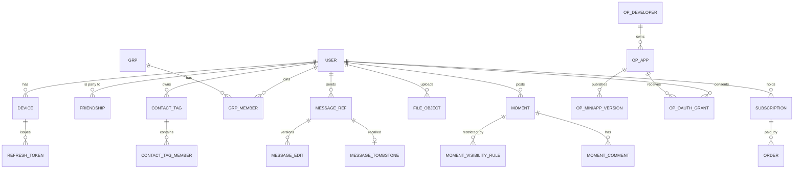

# DATA-MODEL — VeyroGram（Phase 1 草案，Draft）

约束来源：ARCHITECTURE.md AD-5/AD-6/AD-10。仅定义实体、归属与关键不变量；列级 DDL 在 Phase 2 随迁移脚本产出。

## 通用规则
- 每表：`id BIGINT`（内部，时间有序）、`public_id`（不透明，对外）、`tenant_id`（默认 1）、`created_at/updated_at DATETIME(3)`；需要保留/删除的表加 `deleted_at`、`expires_at`。
- 字符集 `utf8mb4`；**`TEXT`/`BLOB` 列不设 DEFAULT**；金额用整数最小单位 + `currency`。
- 敏感字段（手机号、设备标识、通讯录哈希）加密或哈希存储，密钥分级、可轮换；手机号查询用盲索引（HMAC）。
- 模块不得跨表访问：别的模块只能通过 ports 取数据（AD-1）。
- WuKongIM 自有存储保存消息本体；业务库仅存引用、状态与业务扩展（`message_ref`）。

## 实体与归属

| 模块 | 表（草案） | 关键不变量 |
|---|---|---|
| identity | `user`, `user_credential`, `user_privacy_setting`, `mfa_factor`, `passkey_credential`, `login_event` | 手机号唯一（盲索引）；凭据 Argon2id；隐私设置服务端强制 |
| device | `device`, `device_session`, `refresh_token`, `im_token` | refresh 轮换+复用检测；撤销 device 即撤销其全部令牌 |
| contact | `friend_request`, `friendship`, `blocklist`, `contact_tag`, `contact_tag_member` | 好友双向一致；标签仅属主可见 |
| group | `grp`, `grp_member`, `grp_notice`, `grp_blocklist`, `grp_mute`, `grp_invite` | 角色枚举 owner/admin/member；禁言有到期时间；历史可见性字段 `history_visible_from` |
| message | `message_ref`, `message_edit`, `message_tombstone`, `message_reaction`, `read_receipt`, `draft`, `conversation_setting` | `(sender, client_msg_id)` 唯一；撤回=墓碑；已读受隐私设置约束 |
| media | `file_object`, `file_scan_result`, `video_asset`, `location_card` | 状态机 uploaded→scanning→clean/quarantined→deleted（AD-6）；仅 clean 可下载 |
| favorite | `favorite_item` | 仅属主可读；源消息撤回策略字段 |
| sticker | `sticker_pack`, `sticker`, `user_sticker_pack`, `user_custom_sticker` | 自定义表情经审核后可被他人使用；版权来源字段 |
| moment | `moment`, `moment_media`, `moment_visibility_rule`, `moment_comment`, `moment_like`, `moment_notice` | 可见性按当前好友/标签关系重算；删除级联清理 |
| support | `sp_skill_group`, `sp_agent`, `sp_session`, `sp_ticket`, `sp_quick_reply`, `sp_kb_article`, `sp_qa_review`, `sp_work_schedule` | 会话与技能组/租户边界隔离 |
| moderation | `report`, `report_action`, `appeal`, `risk_event`, `risk_rule`, `content_scan_job` | 举报可追踪；处置/申诉分离审核人 |
| admin | `admin_user`, `role`, `permission`, `role_permission`, `approval_request` | 默认最小权限；高危动作需审批 |
| audit | `audit_log` | 追加写；hash 链；应用账号无 UPDATE/DELETE |
| openplatform | `op_developer`, `op_team_member`, `op_app`, `op_app_secret`, `op_oauth_grant`, `op_token`, `op_miniapp_version`, `op_review`, `op_webhook_subscription`, `op_webhook_delivery`, `op_market_listing`, `op_rating` | secret 仅存哈希；redirect URI 精确匹配；版本带签名与灰度比例 |
| billing | `plan`, `entitlement`, `subscription`, `order`, `payment_event`, `coupon`, `refund`, `invoice` | 回调以 `provider_event_id` 幂等；对账表 |
| notification | `push_token`, `notification_pref`, `notification_log` | 通知正文可脱敏；多设备去重 |
| config | `app_version`, `feature_flag`, `download_link`, `announcement`, `config_version` | 配置变更有版本历史与回滚 |
| platform | `outbox`, `dead_letter`, `idempotency_key`, `schema_migration` | outbox SKIP LOCKED；DLQ 可重放 |

## 核心 ERD（仅关系）

## 保留与删除
账号注销、消息/动态删除、文件过期、审计保留期、导出任务保留期均由 `config` 中的保留策略驱动，由 worker 清理（AD-7）；各 FR 的具体期限为待决（OQ-4）。

## 迁移与回滚
前向版本化迁移；破坏性变更两步走（expand → migrate → contract）；每个迁移附回滚说明并在 staging 演练；上游 TangSengDaoDao 现有表的兼容/迁移映射在 Phase 2 前由对 Server `modules/*` 的源码审计产出（目前 UNVERIFIED）。
